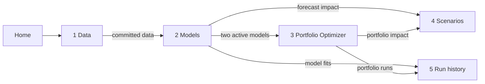

# Forecasting Engine

A Streamlit dashboard that forecasts the returns of two indices over the next 1, 5, 10 or
20 trading days, scores each forecast only on periods the model never trained on, and turns
the forecasts into a long-only equity/bond allocation backtested against a 50/50
portfolio. Built by Finlytics for Alpha Norm (IS484), for a portfolio manager deciding how
to split money between the two indices.

- **Targets:** the S&P 500 and the US Aggregate bond index, both on a total-return basis.
- **Signals:** Bloomberg history exports of market series such as VIX, credit spreads and
  Treasury yields, uploaded exactly as Bloomberg wrote them.
- **Where it runs:** hosted on Streamlit Community Cloud and redeployed from `main` on every
  merge. It also runs on a laptop ([for developers](#for-developers)).

How every step and figure is worked out is in [docs/methodology.md](docs/methodology.md).

## Before you start: the Bloomberg exports

Export each security's daily history from the terminal, one file per security, as CSV or
`.xlsx`, and upload the files as they are. Each file may be up to 25 MB, and so may all of
them merged. [docs/bloomberg-exports.md](docs/bloomberg-exports.md) covers the accepted
layouts and how dates, repeated dates and split histories are read.

| Role | Security | Field |
|---|---|---|
| Equity target | `SPX Index` | `TOT_RETURN_INDEX_GROSS_DVDS` |
| Bond target | `LBUSTRUU Index` | `TOT_RETURN_INDEX_GROSS_DVDS` |

The bond target is the US Aggregate, `LBUSTRUU`. Early exports used `LEGATRUU`, the Global
Aggregate, a different index: re-export it rather than rename it.

**Signals** are every other export; any numeric Bloomberg series is accepted. These nine are
the signals in the history from 31 Aug 2006 that the results below use, and the app knows
how to read each (methodology §4):

| Ticker | Series | Read as |
|---|---|---|
| `VIX`, `JPMVXYGL` | VIX, FX implied volatility | level |
| `LF98OAS`, `LUACOAS` | high-yield and investment-grade credit spreads | level |
| `USGG10YR`, `USGGBE10`, `USYC2Y10` | 10-year Treasury yield, 10-year breakeven, 2s10s slope | change |
| `LF98TRUU`, `DXY` | high-yield total return index, dollar index | log return |

A ticker the app doesn't know is read as a change, and the Models page names it. The
research models need fixed tickers: equity's `LF98OAS`, `LUACOAS`, `VIX` and `USYC2Y10`;
bond's those four plus `USGG10YR`, `USGGBE10` and `JPMVXYGL`. Fama-French 5 needs no
export: its factors are downloaded from Ken French's site when it runs, and kept.

## The journey at a glance

| Step | Page | What you do | What you leave with |
|---|---|---|---|
| 0 | Home | Read where things stand | The next step, with a button to its page |
| 1 | Data | Upload the exports, confirm the targets, click **Use Updated Data** | One committed dataset every other page reads |
| 2 | Models | Run the models on each tab, read the gate, **Set as active** one per index | An active Equity model and an active Bond model |
| 3 | Portfolio Optimizer | Choose a risk level and a minimum in each index | The latest weights, a backtest against 50/50, a saved portfolio run |
| 4 | Scenarios | Shock signals the active models read, click **Run scenario** | Each forecast, and the portfolio, under the shock |
| 5 | Run history | Name, open and compare saved runs | The run's report, as an HTML file |



The status bar on every page shows what the app is working from: **Data** (the dates
committed), **Equity** and **Bond** (the active models) and **Allocation** (the latest
weights). A cell marked **stale** was made from other data or other models than the ones
in use now: redo that step. The foot of the sidebar shows the version and build running.

## Using the app, page by page

### Home: where you are

Home opens on **Next step**, the first thing left to do, with a button to the page where
it's done. The line under it gives the days of data, the signals and how many of the 2
models are active, and ends "up to date" once every step has run; the heading then becomes
the latest weights, with the Sharpe ratio after costs against 50/50. Beside it is the
S&P 500 (live where the feed answers, else from the committed data). **Pipeline detail**
has a card per step and opens by itself while one is left. Home only reads; it never fits or solves anything.

### 1. Data: commit the exports

1. Under **Target index files**, drop the two target exports into **Target exports (.csv
   or .xlsx)**. Each file shows the security found in it, with **Role** (Equity target or
   Bond target) and **Field** (total return, when the file has it) filled in. Check both.
2. Under **Signal files**, drop every other export into **Signal exports (.csv or
   .xlsx)**. They are joined on date, and none can become a target.
3. Under **Use this data**, click **Use Updated Data**. Until then the other pages keep the
   data committed before, or have none. A red message about a file (a date given two
   values, two parts of one history that disagree, one file in both boxes) stops the
   commit until that file is removed, or corrected and uploaded again.
4. Read the **Data quality report**: **Rows**, **Data columns**, **Flagged** and the dates
   covered, then the tabs **Completeness**, **Unusual moves** and **Missing rows**. Nothing
   is changed for you, and no flag stops a run. **Bloomberg merged (.csv)** downloads the
   merged data to read.

If the data starts so early that the first rebalance would fall before May 2005, the page
warns you: the optimiser's long-run premium comes from research published in April 2005.
The commit is saved, so a new window or a reload starts from it ("Using the data committed
…"); **Clear Data** empties this window. Then **Next · 02 Models**.

### 2. Models: run, read the gate, set one active per index

One tab per target: **Equity · S&P 500 (total return)** and **Bond · US Aggregate Bond
(total return)**.

1. **Choose the horizon first.** In **Settings**, pick the **Forecast horizon**: 1, 5, 10 or
   20 trading days (5 by default); changing it later clears the results. The rest is
   fixed: models train on the latest 504 dates (the research models on every earlier
   date, half the Bond derived fits on up to 2,520) and are scored on the next 20, with a
   20-day embargo between; signals are lagged one day; the first 504 dates are kept for
   tuning and never scored.
2. **Tick the models.** All are ticked by default: **Polynomial**, **Fama-French 5**
   (Equity only), the tab's research model and **Machine learning**; the naive baseline
   always runs. Under **Polynomial**, choose **Derive automatically** (**Max terms per
   candidate (optional cap)**, 10 by default) or **Use your own function**: write a shape
   such as `x - 0.5 * y ** 2` and choose the signal each placeholder stands for.
3. **Run.** Click **Run** on a tab, or **Run all targets** to queue both tabs. A banner
   shows each model waiting, fitting (with the time so far) or done, and results appear as
   each finishes. On the data from 2006 the derived polynomial took about two minutes on
   Equity and four on Bond on a laptop. You can leave the page or close the window.
4. **Read the results.** A line per model says whether it met [the gate](#the-gate); in the
   table **Signal Rank IC** and **t** are marked **Gate met** or **Gate failed**, beside IC,
   OOS Rank IC, RMSE, crash diagnostics (never gated), **Rows scored** and **Constant
   folds** (folds forecasting one value throughout). Hover a heading for its meaning.
   Research models are captioned "Scores are optimistic", with their pre-2016 hold-out;
   the Bond derived row says it is provisional.
5. **Look inside.** Each polynomial's expander has its latest fold's equation, how each
   signal is standardised and clipped, a term table and **Feature attribution (SHAP)**.
   **Fama-French 5** and **Machine learning** (with its tuning log) have their own.
   **Signal screening** shows which signals each fold kept.
6. **Would the forecast's direction have paid?** Pick a model in **Forecasts from** to see
   what holding the index only while its forecast is above zero earned against holding it
   throughout (**Long/cash strategy**, **Buy and hold**, **Hit rate**, **Days invested**),
   gross of costs. **Window** narrows the period.
7. **Set one active.** Under **Set active model**, choose a model and click **Set as
   active**. The naive baseline and Fama-French 5 are not offered. A model that failed either
   gate asks first, naming the gate it failed (**Confirm high-risk model**, **Set active
   anyway**); one that passed both is set straight away. Do this on both tabs, at the same horizon.

Then **Next · 03 Portfolio Optimizer**.

### 3. Portfolio Optimizer: weights and backtest

It needs an active model for both indices, run at the same horizon on the data committed
now; otherwise it says what is missing and stops.

1. **Active models** at the top names the two models every figure comes from. Set another
   on Models and the page re-solves with it.
2. Choose **Risk level**, **1 · risk-loving** to **5 · risk-averse** (3 by default),
   **Minimum in each index** (0.20 by default, so at most 0.80 in either) and **Returns**,
   **After costs** or **Before costs**.
3. **Allocation** shows the latest weights, the headline figures (Sharpe after costs and
   1-day VaR 95% against 50/50, forecast value after costs) and a line starting **How this
   was set**: the level's target, the two signals and the tilt they gave. The weights are
   the last rebalance's, up to 23 trading days behind the latest prices at the 5-day
   default; the page says how far.
4. The links under the status bar jump to **Performance** (the backtest against the
   equal-weight benchmark, beside the same level with no forecasts, then cumulative
   return, drawdown and rolling Sharpe), **Significance** (**Is the outperformance
   genuine?** and **Did the forecasts add value?**), **Tail risk** (historical one-day VaR
   and CVaR at 95% and 99%) and **Monte Carlo** (choose a **Sampling method**, optionally
   **Simulated paths** under **Advanced settings**, then **Run simulation**).
5. **Download run report**, at the top, saves the run as one HTML file to open in a browser
   or print to PDF.

The portfolio rebalances every horizon, trading straight back to its target; the benchmark
is reset to 50/50 monthly; costs are 3 bp on equity and 5 bp on bond. Each distinct result
is saved to Run history the first time the page shows it. Then **Next · 04 Scenarios**.

### 4. Scenarios: shock a signal

It needs an active polynomial or machine-learning model, fitted on the committed data, for
at least one index. Its portfolio part also needs the Portfolio Optimizer opened in this
session on the same data and models.

1. In **Signals to shock**, choose signals. Only committed series an active model reads are
   offered, each with the indices that read it ("read by: Equity, Bond").
2. For each, choose **Shock as** (**New value** or **% change**) and enter it, against the
   last observed value shown. A value that isn't a number, takes a gauge, spread or price to
   zero or below, or moves a series more than 10 times its whole observed range is refused.
3. Click **Run scenario**. **Forecast impact** gives each index's base case, shocked
   forecast and change. An index whose model reads none of the shocked signals says so; a
   shocked input outside the range it was trained on gets an extrapolation warning.
   **What each model reads** shows every input before and after.
4. **Portfolio impact** gives both weights (held) and forecasts, then the portfolio's return,
   volatility and maximum drawdown over the next horizon, base against shocked, on the same
   Monte Carlo paths. **Re-optimise under shock** adds the weights the optimiser would
   choose under the shock, without changing the Portfolio page.

A shock moves an index only through the signals its active model reads; no direct effect
of rates or spreads on bond prices is added.

### 5. Run history: the saved runs

Nothing here refits a model or changes the active models.

- **Model fits**: every fit, failures included, newest first, filtered by **Target**;
  **Active** marks the fits the active models came from. **Open a run** shows its status,
  time taken, code version, data (traced to each export under **Lineage: hashes and the
  exports this data came from**), settings, metrics and out-of-sample forecasts.
- **Portfolio runs**: one numbered row per distinct Portfolio result. Name it in its row,
  **Open** it to see what the page showed without recomputing, or download its **Report**.
  **Compare runs** puts every run's settings and Sharpe ratios in one table.

[docs/run-history.md](docs/run-history.md) describes the tables and how to query them.

## Things to know

- **Runs carry on in the background.** A Run is fitted on the server; leaving the page or
  closing the window doesn't stop it. Each model is saved as it finishes and shows when
  you return with the same data and settings. A server fits one Run at a time, in turn.
- **Changing a setting clears the results.** A new horizon or new data empties both tabs
  ("Earlier results for … were cleared"), so a table never mixes settings. A model's own
  setting (the term cap, your function) clears only its row; ticking or unticking a model
  clears nothing. Going back to earlier settings brings their saved results back.
- **The gate and the portfolio's trust gate are separate.** A model can be set active
  without passing the gate. The optimiser then moves the weights only once at least 252
  earlier forecasts of the two active models, checked against what followed, give a slope
  with t above 2 (methodology §17). Until then it holds the risk level's own mix, and **How
  this was set** says when the forecasts are "not used because they are not yet
  statistically reliable". So a model failing the gate moves no weight until its record
  earns trust, and one passing it may still move none. Level 5 ignores forecasts.
- **Active models are shared.** They sit in the app's database with the saved results and
  run history, not per person: setting one active changes it for everyone on that app.
- **A redeploy empties the hosted app.** All it saves is under `data/` on the server: the
  last commit, saved results, active models and run history. After a deploy of `main`,
  commit the data again, press **Run** on both tabs and set the models active again. A
  release that changes a model also makes its saved results refit, as on 18 Nov 2026.

### When a page says something is missing

| The page says | What to do |
|---|---|
| Models: "No data committed yet" | On Data, click **Use Updated Data** |
| Models: "No target resolved yet" | On Data, give each target file a **Role** and commit |
| Models: "No research model for this target" | Upload the export it names, or untick the research model |
| Models: "No transform is defined for …" | Nothing: it is read as a change. To classify it, add the ticker to `TICKER_TRANSFORMS` in `src/forecasting_engine/ingest/align.py` |
| Models: "the Fama-French factors could not be downloaded and none are saved" | Run again with a connection, or untick **Fama-French 5** |
| Portfolio: "Set an active model for …" | On Models, **Set as active** on the tab named |
| Portfolio: "… were run under different settings" | Run both tabs at one horizon and set both active again |
| Portfolio: "… a different dataset or target …"; Scenarios: "… another dataset or target" | Run that model on the data committed now and set it active again |
| Portfolio: "The active model's signal wasn't saved" | Run it again and set it active again |
| Scenarios: "Open the Portfolio Optimizer page first" | Open the Portfolio Optimizer, then come back |
| Scenarios: "… set active before scenarios could stress …" | Set it active again (machine learning: run it again first) |
| Data: "Nothing can be committed until the files marked above are removed …" | Remove the file named in red, or correct it and upload it again |

## Common questions

- **"Did the forecasts add value?" says "No forecast effect to test".** The trust gate never
  opened, so the portfolio equals the level with no forecasts. In the 16 Nov rerun on the
  data from 2006 that was so at 1 and 10 days (methodology §20).
- **A polynomial's equation has no terms.** Its latest fold kept no signal, so it forecasts
  a constant; the expander says how many folds kept a term. It can still be set active.
- **Two people see different figures.** Compare the build at the foot of the sidebar and the
  **Data** cell of the status bar. Machine learning can also come out slightly differently
  on another machine or library version (methodology §9).
- **The Data page's merged CSV is refused when uploaded again.** It is for reading: it has
  no `Security` line, so nothing says which security each column is.

## The models

| Row | Tab | What it is |
|---|---|---|
| Naive (training mean) | both | Each fold's average training return. The baseline the others are read against; no signal, not gated. |
| FF5 Benchmark (**Fama-French 5**) | Equity | Least squares on the five Fama-French daily factors, an academic benchmark. Can't be set active. |
| Polynomial (derived) | Equity | A grid of four fits on the signals each fold's screening kept: lasso at degree 1, 2 and 3 (terms may multiply signals) and a shrinkage fit pulling the slopes towards one common slope. The best Signal Rank IC is reported. |
| Polynomial (derived) | Bond | Since 18 Nov 2026, the mean of 14 fits, none picked: each fits the levels (gauges, spreads, each rate's level) by the bond research model's reduced-bias method and the rest by one of the four fits above, some with calendar counts such as month-ends, on the latest 504 dates or up to 2,520. Provisional until tested on data after 12 Nov 2026 (methodology §9.4). |
| Polynomial – fixed economic inputs | Equity | Research model: a shrinkage fit on the HY and IG credit spreads, VIX and the 2s10s slope as levels. Optimistic: inputs chosen by looking at Aug 2016 – Sep 2024. |
| Polynomial – fixed carry inputs (research) | Bond | Research model: a lasso on the levels of seven rates, spreads and gauges, each one's unexpected move over the horizon taken out. Optimistic: inputs chosen on the Sep 2026 upload. |
| Polynomial (user-supplied) | both | Your shape in the signals; only a scale and an intercept are fitted. |
| Machine Learning | both | XGBoost and LightGBM, tuned with Optuna about once a year; the better is reported, with SHAP. |

### The gate

A model passes only if its **Signal Rank IC** is above 0.02 and its **t** is above 2
(`validation/gates.py`). The Signal Rank IC is what the forecast adds to the model's own
average forecast, ranked against the returns that followed, over every test window; t is
that figure over the larger of its two standard errors, which allow for overlapping returns
(methodology §10, §12). Every row but the naive baseline is gated.

### Results on the data from 2006

On the 11 Bloomberg exports from 31 Aug 2006 to 11–12 Nov 2026, at the page's defaults
(a 5-day horizon since 19 Nov 2026; methodology §20,
[evidence](docs/evidence/2026-11-19-default-horizon.md)):

- **Equity:** at 5 days three models pass the gate: the derived polynomial (+0.083,
  t 3.20), the research model (t 2.10, optimistic) and machine learning (t 2.34).
  Fama-French 5 fails (t 1.27). The derived polynomial also passes at 1 and 10 days and
  misses at 20 (+0.103, t 1.98).
- **Bond:** no bond model passes at 5 days. The derived polynomial, the mean of 14 fits
  since 18 Nov, passes only at 1 day (+0.045, t 2.86); at 5 days it is +0.037 (t 1.29)
  and at 20 days +0.065 (t 1.08). It is positive in both decades and on a public 1992 to
  2006 hold-out (methodology §9.4, [evidence](docs/evidence/2026-11-18-bond-holdout.md)).
- **At 20 days, the default until 19 Nov, no model passes for either index**, and both
  research models score near zero on their pre-2016 hold-out.
- **Portfolio:** with the derived polynomial for both indices at 5 days, level 3 earns
  8.67% a year after costs against 8.32% for 50/50 (t 2.06), and 8.69% with no forecasts
  (t −0.11). So the risk level's mix beats 50/50 and the forecasts add nothing: they were
  trusted at 112 of 904 rebalances. Net Sharpe runs from 0.78 at level 1 to 1.03 at
  level 5, against 0.88 for 50/50. The forecasts added no value at any horizon, and an
  earlier run with machine learning for bond cost significantly at 5 days, levels 1 and 2
  ([evidence](docs/evidence/2026-11-16-full-history.md)).

## For developers

### Getting started

Requires Python 3.11+ and [uv](https://docs.astral.sh/uv/) (on macOS, `brew install uv`).
`.python-version` pins 3.13, the version CI runs on; uv downloads it if needed.

```bash
uv sync --all-extras
uv run streamlit run app/Home.py
```

It opens at <http://localhost:8501>. `.devcontainer/devcontainer.json` does the same in a
Codespace.

- **Edits aren't picked up by themselves:** `.streamlit/config.toml` turns the file watcher
  off to keep first page loads quick. While developing, add `--server.fileWatcherType auto`.
- **State is under `data/`** (gitignored): `forecasting.duckdb` (run history, active models,
  portfolio runs, upload log), `last_commit.pkl`, `model_runs/` (the Models page's result
  cache) and `uploads/`. The app holds `forecasting.duckdb` open while it runs, so nothing
  else can open it meanwhile. Delete `data/` to start from nothing.
- **Processes:** a Run spreads independent work over up to 4 processes; set
  `FORECASTING_WORKERS` (for example `8`, or `1` for none) before starting the app. The
  results are the same either way.
- **Network:** Fama-French 5 downloads its factors on first use, and Home's S&P 500 chart
  reads a live feed, falling back to the committed data.

### Checks and CI

```bash
uv run ruff check .
uv run pytest
```

[CI](.github/workflows/ci.yml) runs both, lint first, on every pull request and every push
to `main`. The tests are unit, integration and functional (each page driven through
Streamlit's `AppTest`). `tests/unit/test_methodology_doc.py` fails if a constant changes
without [docs/methodology.md](docs/methodology.md), and `tests/unit/test_tokens.py` if the
colours in `app/tokens.py` and `.streamlit/config.toml` drift apart.

### Deployment

The dashboard is hosted on Streamlit Community Cloud, connected to this repository's `main`
branch: merging a pull request redeploys it, with no manual step. The entry file is
`app/Home.py`. Each deploy starts with an empty `data/` ([things to know](#things-to-know)).

### Repository layout

```
src/forecasting_engine/   the library; never imports Streamlit
  extraction/             read, merge and check Bloomberg CSV and XLSX exports
  ingest/                 upload limits, Fama-French factors, lag-safe alignment, S&P 500 feed
  features/               per-fold signal screening
  models/                 naive, Fama-French, the polynomials (lasso, shrinkage, user's own,
                          the two research models, the bond mean of 14), boosted trees
  validation/             walk-forward splitter, harness, metrics, crash checks, gates
  portfolio/              optimiser, backtest, performance, directional P&L
  risk/                   historical VaR and CVaR, Monte Carlo
  scenario/               signal shocks and their portfolio impact
  reporting/              tables, labels, SHAP, the run report
  store/                  DuckDB: run history, uploads and lineage, active models, portfolio runs
app/                      the dashboard; no maths
  Home.py                 entry file: the sidebar navigation
  app_pages/              the six pages, 0_Home.py to 5_Run_History.py
  shell.py                the status bar
  bloomberg_extraction_panel.py   the Data page
  model_jobs.py, model_runs.py    the background Run queue; which results a setting clears
  ui.py, charts.py, tokens.py, glossary.py   presentation, charts, colours, hover help
docs/                     methodology, data, evidence and design records
tests/                    unit, integration, functional
```

### Documentation

| Document | What it holds |
|---|---|
| [Methodology](docs/methodology.md) | Every step, model, gate and parameter, and the latest results (§20); the tests check it against the code |
| [Bloomberg exports](docs/bloomberg-exports.md) | What to export and how the Data page reads it |
| [Run history](docs/run-history.md) | The DuckDB tables, their guarantees and example queries |
| `docs/evidence/` | One dated note per decision, most with the script that produced it; the latest are the [full history rerun](docs/evidence/2026-11-16-full-history.md) (16 Nov) and the [bond hold-out](docs/evidence/2026-11-18-bond-holdout.md) (18 Nov) |
| [Outlier detection](docs/outlier-detection.md) | The method behind "Unusual moves" and its calibration |
| [Sponsor notice](docs/sponsor-notice-2026-11.md), [Word documents out of date](docs/word-docs-out-of-date-2026-11.md) | The November 2026 changes as notified to the sponsor, and the Word passages they affect |
| [Validation review](docs/validation-review.md), [data specification](docs/data-specification.md), [quality report contract](docs/quality-report-contract.md), [market calendars](docs/market-calendars.md), [ingestion consolidation](docs/ingestion-consolidation.md) | Records kept for their reasoning, each with a note on what has since changed |
| [Architecture design](docs/superpowers/specs/2026-07-29-forecasting-engine-architecture-design.md), [team guide](docs/architecture.html), `docs/superpowers/` | The July 2026 design before the build, with a note on where the built app differs, and the later specs and plans |
