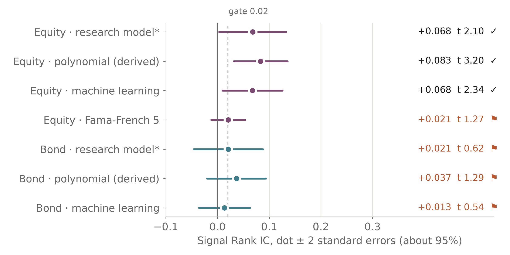
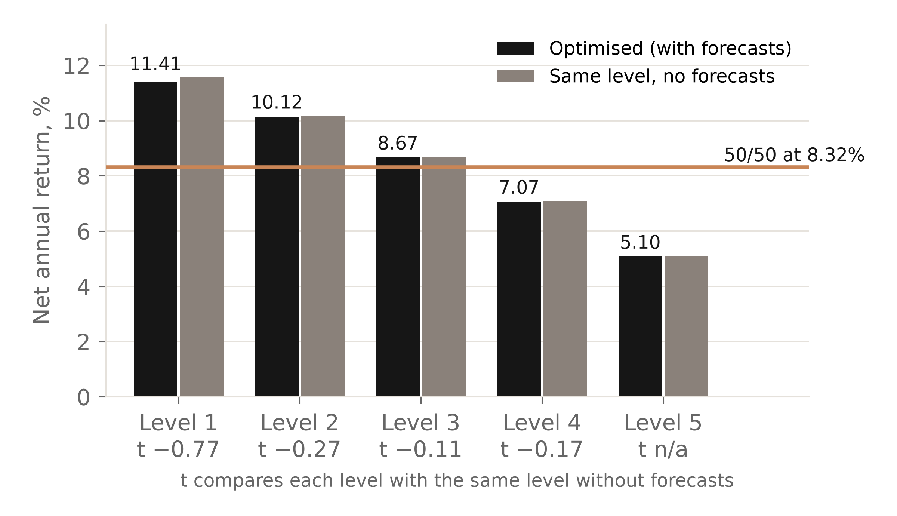

# The default horizon moves to 5 days, 19 Nov 2026

The Models page's default horizon (`DEFAULT_HORIZON`) is now 5 days; it was 20. This note
holds the scores behind the change, and the first portfolio runs on the bond derived model
of 18 Nov 2026 (the mean of 14 fits, methodology §9.4), which §20 had not recorded.

**How it was run.** The app itself, started locally from this change on main `c39abff`, on
the 11 Bloomberg exports from 31 Aug 2006 to 11–12 Nov 2026. At each horizon: upload, Use
Updated Data, Run all targets with machine learning unticked, the derived polynomial set
active for both indices, then the Portfolio Optimizer. The 20-day run is from earlier the
same day on main `203c92c`, whose model and portfolio code is the same. Machine learning
was also run for equity at 5 days and matched the 16 Nov run to four decimals; the bond
machine learning figure is the 16 Nov run ([full history](2026-11-16-full-history.md)).
The level tables are computed from the stored runs by `run_levels` and `level_rows` in
[`2026-11-16-optimiser-fixes.py`](2026-11-16-optimiser-fixes.py), and agree with the page
at level 3. The browser scripts that drove the page are not in this repository.

**The default was chosen after these scores were seen.** 5 days is where the equity derived
polynomial's t is highest on this data (its Signal Rank IC is higher at 10 and 20 days), so
that t of 3.20 is the best of four horizons and was not a test set aside in advance. Data after 12 Nov 2026 is the clean test.

## Models

Signal Rank IC and t (methodology §10) and the gate (§12), on tests from Oct 2008 to Nov
2026.

| Target | Model | h = 1 | h = 5 (default) | h = 10 | h = 20 |
|---|---|---|---|---|---|
| Equity | Polynomial (derived) | +0.033, t 2.10, passes | +0.083, t 3.20, passes | +0.104, t 2.84, passes | +0.103, t 1.98, fails on t |
| Bond | Polynomial (derived), mean of 14 fits | +0.045, t 2.86, passes | +0.037, t 1.29 | +0.019, t 0.46 | +0.065, t 1.08 |

At the 5-day default:

| Target | Model | Signal Rank IC | t | Gate |
|---|---|---|---|---|
| Equity | Polynomial (derived) | +0.0833 | 3.20 | passes |
| Equity | Polynomial – fixed economic inputs | +0.0679 | 2.10 | passes |
| Equity | Machine learning | +0.0676 | 2.34 | passes |
| Equity | Fama-French 5 | +0.0208 | 1.27 | fails on t |
| Bond | Polynomial (derived), mean of 14 fits | +0.0367 | 1.29 | fails on t |
| Bond | Polynomial – fixed carry inputs | +0.0207 | 0.62 | fails on t |
| Bond | Machine learning (16 Nov run) | +0.0133 | 0.54 | fails on Signal Rank IC and t |

## Portfolio, derived polynomial for both indices

Net of 3 bp equity and 5 bp bond, 6 Oct 2008 to Nov 2026. "t vs no forecasts" compares each
level with the same level at no forecasts; 50/50 earns 8.32% a year at a net Sharpe of 0.88.

| h | Rebalances | Trust gate open | t vs no forecasts, levels 1–4 | Level 3 net return | Level 3 t vs 50/50 |
|---|---|---|---|---|---|
| 1 | 4,520 | never | identical paths | 8.80% | 3.69 |
| 5 | 904 | 112 (16 Sep 2016 – 7 Dec 2018) | −0.77, −0.27, −0.11, −0.17 | 8.67% | 2.06 |
| 10 | 452 | never | identical paths | 8.68% | 2.97 |
| 20 | 226 | 7 (19 Nov 2009 – 14 May 2010) | −0.04, −0.16, −0.38, −0.58 | 8.63% | 1.53 |

The forecasts add nothing at any horizon. Level 3 beats 50/50 at 1, 5 and 10 days, and the
same level with no forecasts earns as much or more (8.69% at 5 days), so that gain comes
from the mix the level holds.

Every level at the 5-day default:

| Level | Net annual return | Net Sharpe | Max drawdown | Turnover a year | Costs a year | t vs 50/50 | t vs no forecasts |
|---|---|---|---|---|---|---|---|
| 1 | 11.41% | 0.78 | −28.5% | 122% | 0.049% | 3.09 | −0.77 |
| 2 | 10.12% | 0.82 | −23.8% | 144% | 0.058% | 3.10 | −0.27 |
| 3 | 8.67% | 0.87 | −20.0% | 134% | 0.054% | 2.06 | −0.11 |
| 4 | 7.07% | 0.94 | −18.7% | 103% | 0.041% | −2.85 | −0.17 |
| 5 | 5.10% | 1.03 | −17.7% | 28% | 0.011% | −2.92 | n/a |
| 50/50 | 8.32% | 0.88 | −19.9% | 20% | 0.008% | n/a | n/a |

