# Methodology

What the engine does to a Bloomberg export before a model is scored, and how
each model is fitted, scored, selected and gated. Every value below is the
code's own constant, named with its module; the [parameters table](#parameters)
lists them all, and `tests/unit/test_methodology_doc.py` fails if any of them
changes without this document being updated.

Module paths are relative to `src/forecasting_engine/` unless they start with
`app/`.

## Pipeline

```mermaid
flowchart TD
    A["1. Ingest and parse<br/>extraction/bloomberg_csv, bloomberg_xlsx, validation"] --> B
    B["2. Target calendar and as-of alignment<br/>ingest/align.py"] --> C
    C["3. Signal selection<br/>ingest/align.select_signals"] --> D
    D["4. Transform<br/>ingest/align.TICKER_TRANSFORMS"] --> E
    E["5. Lag one row<br/>ingest/align.PRODUCTION_LAG_DAYS"] --> F
    F["6. Forward-return target<br/>ingest/align.align_and_lag"] --> G
    G["7. Walk-forward split<br/>validation/splitters.PurgedWalkForward"] --> H
    H["8. Per-fold screening<br/>features/screening"] --> I
    I["9. Fit each model family per fold<br/>models/"] --> J
    J["10. Pooled metrics<br/>validation/harness.summarize"] --> K
    K["11. Selection<br/>validation/harness.select_best_candidate"] --> L
    L["12. Gates<br/>validation/gates"]
    J --> M["13. Naive baseline row<br/>models/naive"]
    J --> Q["17. Optimiser: 50/50 tilted by the signals<br/>portfolio/optimize"]
    Q --> N["14. Portfolio backtest vs 50/50<br/>portfolio/backtest, portfolio/performance"]
    N --> P
    J --> O["15. Directional P&L vs buy-and-hold<br/>portfolio/directional"]
    P["16. Historical VaR and CVaR<br/>risk/tail"]
    I --> S["18. Signal shock scenarios<br/>scenario/shock"]
```

Step 14 consumes the optimiser's weight schedule (step 17), built from the active
models' signals: it judges an allocation, not a forecast. Step 15 replays one model's out-of-sample
forecasts for one index. Step 18 evaluates the active polynomials again on
shocked inputs, without refitting.

## 1. Ingestion and parsing

Targets and signals are uploaded separately on the Data page, so which series is
a target is decided at ingestion, never inferred later.

- **Reading.** A CSV export is a metadata block then a table headed `Date,...`,
  found by scanning rather than at a fixed row (`extraction/bloomberg_csv.py`).
  An `.xlsx` export is read from its first sheet, laid out like the CSV export:
  its rows become CSV lines and go through the same parser
  (`extraction/bloomberg_xlsx.py`). Only saved values are read; a formula with no
  saved value refuses the file. A workbook with a `Data` sheet is read the older
  way, from `Data` and `Metadata`. Every data column is renamed
  `{security}_{field}`, e.g. `VIX_Index_PX_LAST`. Files over `MAX_UPLOAD_BYTES`
  are refused (`ingest/upload.py`).
- **Per-file schema.** Each file is checked on its own before merging
  (`extraction/validation.schema_errors`). A column whose name contains a
  `POSITIVE_FIELD_MARKERS` entry (a total-return index) must be positive; one
  containing a `NUMERIC_FIELD_MARKERS` entry need only be numeric, since
  `PX_LAST` is any series' last value and a curve can be negative; any other must
  lie within `SANE_RANGE`. A failing file is excluded, and the good files still merge.
- **Merge.** Files are outer-joined on `Date`. Two files sharing a security are
  relabelled by file name. A column with no value on any date is dropped
  (`bloomberg_csv.drop_empty_columns`), and the drop is listed in the data quality
  report.
- **Target roles.** A target file's security pre-fills its role from
  `TARGET_TICKERS`, and its field defaults to `PREFERRED_FIELD` (total return).
  The person uploading confirms or changes both.
- **Report, not correction.** The data quality report counts duplicate and
  weekend dates, missing values per column, and day-over-day changes whose robust
  (median-absolute-deviation) z-score exceeds `MAD_THRESHOLD`. Nothing in it is
  auto-corrected.
- **Commit.** "Use Updated Data" commits the merged frame, the target columns and
  each column's security and field (`bloomberg_csv.column_sources`). Nothing is
  forward-filled.

## 2. Target calendar and as-of alignment

`ingest/align.align_and_lag` builds one panel per target:

1. The calendar is the dates the target has a price. Every other row is dropped.
   The target is never filled.
2. Each signal takes its last observed value on or before each calendar date.
   A value more than `MAX_STALENESS` calendar rows old is treated as missing. The
   Fama-French factors are matched by exact date only, never carried forward.
3. The Models page reports, per signal, how many values were carried forward and
   how many rows have no value once transformed and lagged.

## 3. Signal selection

`ingest/align.select_signals`:

- Every field of a target's security is left out, not only the target column,
  for both targets. The target securities come from the committed target
  assignment, never from a hard-coded list.
- Each security contributes one column: its `TOT_RETURN_INDEX` field if there is
  one, otherwise `PX_LAST` (`_PRICE_FIELD`), otherwise its first other field. Bid
  and ask quotes (`_QUOTE_FIELDS`) are never used.

## 4. Transform map

`ingest/align.TICKER_TRANSFORMS` classifies each ticker by the kind of series it
is:

| Category | Tickers | Transform |
|---|---|---|
| Risk gauges | VIX, JPMVXYGL, LUACOAS, LF98OAS | level (used as is) |
| Rates and curve | USGGBE10, USGG10YR, USYC2Y10 | difference |
| Prices and total-return indices | LF98TRUU, LEGATRUU, LBUSTRUU, SPX, DXY | log return |

Any field starting `TOT_RETURN_INDEX` is a log return whatever its ticker. A
signal with no known ticker is treated as `UNCLASSIFIED_TRANSFORM`, and the Models
page names it in a warning. Transforms are computed on the target calendar, so a
change spans any dropped date. The Fama-French factors are daily returns already
and enter as levels.

## 5. Lag

Every signal is shifted forward `PRODUCTION_LAG_DAYS` row on the target calendar
(`ingest/align.py`), so a value dated today is one that was published before
today's forecast. It is a constant, not a setting.

## 6. Target construction

The target is the simple forward return over `h` rows of the target calendar,
`price[t+h] / price[t] - 1`, for the chosen horizon `h` in `HORIZONS`
(`app/model_settings.py`, default `DEFAULT_HORIZON`). `label_end` records the
date of the price each label reaches, which the splitter uses to purge.

## 7. Walk-forward splitter

`validation/splitters.PurgedWalkForward`:

- **Tuning period.** The first `TUNING_ROWS` rows are reserved. No test window
  starts before `max(train, TUNING_ROWS) + embargo`, for every model family, so
  machine-learning tuning never touches a reported result.
- **Windows.** Test windows of `DEFAULT_TEST_WINDOW` rows roll forward by that
  many rows. Each training window is the `TRAIN_WINDOW` rows ending `embargo` rows
  before its test window, and may reach back into the tuning period. Both windows
  are the same for every model on both targets (the research model, §9.1, alone
  trains on every earlier row, on the same test windows), and fixed rather than settings:
  trying windows until one scores well is overfitting that no single run can see.
  Every row of the results table is therefore scored on the same dates, and both
  targets forecast the same rebalance days.
- **No expanding window.** On the Sep 2026 data (12 Oct 2026 verification,
  [evidence](evidence/2026-10-12-design-verification.md)), the rolling 504-row window scored the
  highest equity derived Signal Rank IC (+0.145, t 2.20), and neither an expanding
  window (+0.139) nor one capped at the latest 1,260 rows (+0.117) beat it by more
  than a standard error; on bond both scored below it. Folds of the expanding
  window trained on under five years scored +0.225, those on five years or more
  +0.075, so a longer history did not help. `splitters.expanding` remains only
  for the research model (§9.1).
- **Embargo.** `EMBARGO_DAYS`, the longest horizon (20 days), whichever horizon is
  chosen.
- **Purge.** A training row is dropped if its label's price (`label_end`) is dated
  on or after the test window opens, or if it lies within `h` rows of it.
  `window_before` applies the same purge to tuning windows.

## 8. Per-fold screening

For the derived polynomial and machine learning, each fold screens every
candidate signal on its own training window only (`features/screening.py`). A
signal is kept when the absolute rank IC of the signal against the target is
greater than `INCLUSION_THRESHOLD` (strictly). If a fold keeps no signal, no
model is fitted on it: the fold forecasts its training window's mean target for
every row, with no terms and that mean as its intercept
(`validation/harness.evaluate`). Fitting on the signals that just failed the gate
would let them back in. The Models page shows each signal's transform, its
latest-fold in/out and IC, and how many folds kept it, and says under each
screening model how many folds had no signal pass.

## 9. Model families

Every family on a target tab runs in one Run under the same shared settings —
horizon, lag, walk-forward windows, embargo and so folds — and the results table
states those settings above its rows. Changing any of them clears every tab's
rows together (`app/model_runs.py`); a model's own setting (the derived
polynomial's term cap, the user's formula and the signal each placeholder stands
for) clears only that model's row. Every
family is optional; Run is disabled until one besides the naive baseline is
ticked, and the naive baseline runs with every Run. The polynomial runs one
source at a time, derived or the user's own function, each under its own row
name, and switching source clears nothing. The Equity tab also offers the
research model (§9.1) under its own checkbox and row, beside whichever polynomial
runs. Each family chooses only among its own
configurations, so which families run together never changes any family's
result.

Each family is fit per fold on the training window and predicts the test window.
A row missing any signal a model uses is left out of that model's fitting and
scoring (`ModelRunResult.rows_scored` reports how many rows were scored).

Work that does not depend on other work runs in separate processes
(`parallel.map_processes`, started fresh rather than forked): the derived
polynomial's configurations and each machine-learning library's tunes and fits.
The answer is the same as running them in turn; on the Sep 2026
data a polynomial run took 97 s instead of about 250 s, and machine learning 196 s
instead of 371 s, with 4 processes. `FORECASTING_WORKERS` sets how many processes
a run may use (default at most `DEFAULT_MAX_WORKERS`; 1 runs everything in turn).

- **Fama-French 5** (`models/famafrench.py`, equity target only). OLS with an
  intercept of the target on the five `FACTOR_COLUMNS`, lagged like any signal.
  The regression target is the raw forward return, not the excess return.
  Factors are resolved when the model is run (`ingest/fama_french.resolve`): a
  saved copy younger than `MAX_AGE`, otherwise a fresh download (timeout
  `_TIMEOUT_SECONDS`), falling back to the saved copy with a warning, and an
  error if there is neither. A fold needs at least `_MIN_TRAINING_ROWS` complete
  rows. No configuration search.
- **User polynomial** (`models/polynomial.UserPolynomial`). The user writes the
  shape `f` with placeholders (`x`, `y`, ...) and picks the signal each one
  stands for; a placeholder named after a signal column defaults to it. In each
  fold, `forecast = a + b × f` is fitted by ordinary least squares on the
  training rows where both `f` and the target are present, so the forecast is a
  return rather than a signal's level. If `f` is constant there, `b` = 0 and the
  fold forecasts its training mean. No screening. The page shows the latest
  fold's `a + b × (formula)` and the signal table beside the box (column,
  security, field, transform, 1-day lag, latest value after both). One
  configuration.
- **Derived polynomial** (`models/polynomial.run_derived_polynomial`). The grid is
  a Lasso fit (`CANDIDATE_REGULARIZERS`, an L1 share of 1 in `_REGULARIZERS`) at
  every degree in `CANDIDATE_DEGREES`, `models/polynomial.DerivedPolynomial`, plus
  one shrinkage candidate (`SHRINKAGE`, below): four setups. `MAX_DEGREE` still
  caps a user's function. Elastic net and degrees 4 and 5 left the grid on 12 Oct
  2026: elastic net's forecasts correlated 0.98–1.00 with lasso's at the same
  degree on both targets, so it gave selection nothing to choose between, and
  degrees 4 and 5 were never chosen while a single degree-5 fold took 6–9 minutes
  ([evidence](evidence/2026-10-12-design-verification.md)). Every candidate fits the signals that
  fold's screening kept (§8). For the lasso candidates, per fold:
  1. each raw signal is clipped to its training mean ± `CLIP_SD` standard
     deviations, and those bounds are shown beside the equation;
  2. each clipped signal is standardised with the same mean and SD,
     `z = (x − mean) / sd`, and the `z` values are expanded with
     `PolynomialFeatures`. A level and its square move almost together (VIX and
     VIX² correlate at about 0.995), so the penalty can't tell them apart; a
     centred signal and its square barely correlate;
  3. the penalty is chosen by time-ordered cross-validation (`TimeSeriesSplit`,
     up to `INNER_CV_SPLITS` folds, gap = `h`, fewer folds when the window is
     short) over `_N_ALPHAS` penalties spanning a factor of `_ALPHA_EPS`, by mean
     squared error. Each split standardises every expanded term using its own
     training rows only, so the rows that judge a penalty never help shape what
     it is judged on. No term is pre-selected: the penalty alone decides which
     survive;
  4. the term cap `max_terms` (default `DEFAULT_MAX_TERMS`) works through the
     penalty. The whole training window's penalty path is walked from the
     largest penalty down, `_PATH_CHUNK` penalties at a time, and stops at the
     first penalty whose fit has more than `max_terms` non-zero coefficients; the
     penalties before it are eligible, and the cross-validated best among them
     is chosen, or the largest penalty if even that exceeds the cap. The small
     penalties a cap rules out are also the slowest to fit, so they are never
     computed. The model is that whole-window fit at the chosen
     penalty; no coefficient is set to zero by hand;
  5. the coefficients are converted back from the scaled terms for display, so
     the equation, written in the standardised signals (e.g.
     `0.0012 + 0.0004·z_VIX − 0.0002·z_VIX²`), reproduces the predictions. Each
     signal's mean and SD (`ModelDescription.standardisation`) are shown under
     it, e.g. `z(VIX) = (VIX − 18.20) / 6.100`.

  A fold needs at least `_MIN_TRAINING_ROWS` complete rows.

  The **shrinkage candidate** (`models/shrinkage.ShrinkagePolynomial`) is a
  degree-1 fit whose slopes are shrunk toward one common slope. Signals that move
  together (the two credit spreads and VIX) are averaged rather than picked
  between, which a lasso does not do: it keeps one of a correlated group and drops
  the rest. Per fold, on the screened signals and the training rows only:
  1. each signal's direction is the sign of its training Rank IC;
  2. oriented, clipped to its mean ± `CLIP_SD` standard deviations and
     standardised, `z = (x − mean) / sd`;
  3. the slopes are the posterior mean of a Bayesian regression whose prior
     pulls them toward one common slope `m ≥ 0` (an exchangeable horseshoe; `m`
     has prior scale `COMMON_SLOPE_SCALE`). The likelihood is divided by the
     labels' overlap, `1 / (1 − lag-1 autocorrelation)`, capped at
     `MAX_OVERLAP`, so `h`-day labels count as about `n / h` independent periods;
  4. the posterior is drawn by Gibbs sampling, `CHAINS` chains of `BURN_IN`
     discarded and `KEPT_SWEEPS` kept sweeps from `SEED`, so a fit is
     reproducible;
  5. the level is the training mean, as for every other model, so what it adds
     to the naive forecast is its slopes alone.

  The equation is `mean + Σ β·z`, one term per signal, written in each signal's
  own direction. A fold needs at least `_MIN_TRAINING_ROWS` complete rows. The
  shrinkage idea comes from the October 2026 model research (below); the
  literature behind it is Campbell & Thompson (2008) on economically restricted
  return forecasts and Rapach, Strauss & Zhou (2010) on combining correlated
  predictors. On the Sep 2026 data it was the best candidate for both targets at
  every fold placement tried; degrees 4 and 5 were never chosen.
- **Machine learning** (`models/boosted.py`). XGBoost and LightGBM, each with
  `_FIXED_PARAMS` and gain feature importance, and minimum leaf size
  (`_LEAF_KEYS`) capped at `LEAF_CAP_SHARE` of a fit's training rows.
  Hyperparameters come from Optuna (TPE, seed 0) over `SEARCH_SPACE`, scored by
  pooled Rank IC over a mini walk-forward inside the tuning window, with the main
  run's test window and embargo and a train window of at most
  `TUNING_TRAIN_WINDOW` rows, so a 504-row main window can still be tuned inside
  the 504-row tuning period. A trial with undefined Rank IC scores worst. Both
  libraries fit on one thread: otherwise their fits depend on how many cores
  the machine has, and the same run could pick a different library on a laptop
  than on the hosted app.
  - The first tune uses the `TUNING_ROWS` rows before the first test window,
    with `N_TRIALS` trials.
  - A re-tune happens at the first fold whose test window opens `RETUNE_EVERY`
    rows after the previous tune. It uses the `TUNING_ROWS` rows just before that
    test window, purged by `label_end`, and runs `RETUNE_TRIALS` trials,
    starting from the previous best.
  - Each fold uses the most recent tune. A tuning window holding fewer than
    `MIN_TUNING_FOLDS` mini folds is refused before any tuning starts, and the
    Models page offers machine learning only when it can hold them
    (`fits_tuning_period`), which it always can at the default windows. On the
    Sep 2026 data machine learning scored higher at 504 rows than at 252 on both
    targets (equity +0.044 to +0.069, bond +0.044 to +0.114).
  - Tuning searches over every signal; each fold's fit uses its screened
    signals.
  - A fold needs at least `_MIN_TRAINING_ROWS` complete rows.
  - SHAP (mean |SHAP value| per signal) is computed once, for the winning
    library's last fold, refitted with that fold's tune.

### 9.1 Polynomial – fixed economic inputs

`models/sign_ruled.run_sign_ruled_polynomial`, the row "Polynomial – fixed
economic inputs", Equity tab only, with its own checkbox. It is the model the October 2026
model research chose from about 300 trials, run exactly as origin/main ran it as
its derived polynomial (`cbd1a64`): a shrinkage fit
(`SignRuledPolynomial`) on four fixed inputs, `ECONOMIC_INPUTS` (HY OAS, IG OAS,
VIX and the 2s10s slope, each with a sign of +1), read as levels whatever the
transform map says (§4 differences the 2s10s slope), each clipped to its training
mean ± `CLIP_SD` standard deviations and standardised, with the forecast's level
the mean of the first `LEVEL_ROWS` training labels, and the shrinkage sampler's
settings of the derived polynomial's shrinkage candidate (`COMMON_SLOPE_SCALE`,
`MAX_OVERLAP`, `CHAINS`, `BURN_IN`, `KEPT_SWEEPS`, `SEED`). A fold needs at least
`_MIN_TRAINING_ROWS` complete rows. The inputs are found by ticker; if the
committed data lacks one, or holds two columns for one, the tab says so and the
row does not run. `tests/unit/test_sign_ruled.py` checks its pooled forecasts,
baselines and realised returns against ones produced by origin/main's code.

**Why an expanding window and fixed inputs when everything else uses 504 rows
and per-fold choices.** The row exists to reproduce the research result, and that
result is the fit on these inputs on an expanding window: the research found the
edge needed every earlier row and disappeared in a 252-row rolling window, so
running it at 504 rows would be a different model with no research behind it.
Its windows are `splitters.expanding` of the page's splitter: the same test
windows and embargo, with the first test window opening where every other
model's does, so its rows are scored on the same dates as every other row and
its forecasts line up with the bond model's rebalance days. Only the training
window differs, so it is set active with no train window (`train_window` is
`None`), which `store.active_model.settings_match` allows: what a two-asset run
needs is the same horizon, test window and dataset.

**Why its score is optimistic.** Its inputs, their signs and its level were
chosen by looking at results over Aug 2016 – Sep 2024, which overlaps the scored
period, and no out-of-sample score can count those choices. On the Sep 2026 data
it scored an equity Rank IC of +0.24 (+0.32 on Oct 2024 – Sep 2026, the only part
out of sample for it, t about 2.2 on about 24 independent 20-day periods),
against +0.12 for the screened shrinkage candidate; its research notes say over
half of that came from one quarter (the spring 2025 spread spike and rebound) and
that the 1990–2016 history points the other way. Its fixed inputs also ignore any
other signal in the data. The page therefore captions its row: "Inputs and signs
chosen in the Oct 2026 model research on data overlapping this test period; treat
its score as optimistic." The derived polynomial makes every such choice inside
each fold instead.

It is gated like every other model (§12) and can be set active for equity like
any model, so the optimiser can use either it or the derived polynomial. The
active-model store saves its forecast and each date's baseline, its fold's
training-mean target, so its signal is `forecast − baseline`
(`harness.signal_forecasts`), as for every model.

### 9.2 Feature attribution (SHAP) for polynomial models

`reporting.shap_attribution.polynomial_shap`. Every polynomial-shaped row
(derived, fixed-economic-inputs, user-supplied, and Fama-French) gets a mean
|SHAP value| per signal, shown beside its fitted terms in the same table
format the boosted models already use (§9's last bullet). Unlike a boosted
model's sampled SHAP, a polynomial's is computed exactly, since its equation
is known: each term's value decomposes across its distinct signals by the
closed-form Shapley value for a product, relative to each factor's mean over
the displayed fold's own training rows (`validation.splitters.
last_fold_train_window`, so nothing is refitted). A plain linear term reduces
to coefficient × (value − training mean); a power of one signal (`x²`)
attributes wholly to that signal; an interaction splits between its signals so
their shares always sum back to the term's own contribution. Terms sharing a
signal (e.g. `x` and `x²`) are summed into one row. `None` where the function
has no terms to attribute to a signal (a user formula that divides by a
signal, or expands past 50 terms). `tests/unit/test_shap_attribution.py`
checks the degree-1 case against the closed form directly and the interaction
case's conservation property (the two signals' shares sum to the term's own).

## 10. Metrics

`validation/harness.summarize` pools every fold's test predictions and realised
values end to end, then computes once:

- **IC**: the Pearson correlation of prediction and outcome. It mixes the scales
  of different folds' fits, so it is not gated.
- **Signal Rank IC** (`validation/harness.signal_forecasts`), the gated figure:
  the Rank IC of each fold's predictions less that fold's training-window mean
  target, pooled. The training mean is what the naive baseline forecasts, so this
  scores what a model adds to it. A forecast's level moves with its fold's
  training mean whatever the signals say, and on the Sep 2026 Bloomberg data that
  trailing mean ranked future equity returns the wrong way (pooled Rank IC down to
  −0.25 at a 20-day horizon): pooled whole, the level swamped signals that were
  there. `ModelRunResult.baseline` keeps each date's training mean, so the
  portfolio optimiser can read the signal back.
- **OOS Rank IC**: the Spearman correlation of the whole forecast, its level
  included, computed as the Pearson correlation of ranks. Shown, not gated.
- **RMSE.**
- **Two Newey-West standard errors of each of those Rank ICs** (`validation/metrics.rank_ic_se`).
  Each regresses the standardised ranks of the outcome on those of the prediction
  with a HAC covariance: "s.e. (h−1 lags)" allows for overlapping h-day labels,
  and "s.e. (test-window lags)" uses as many lags as a test window has rows,
  allowing for errors shared within a fold's single fit.
- **Rows scored**: test rows with both a prediction and an outcome.
- **t** (`ModelRunResult.signal_t`): the Signal Rank IC over the larger of its
  two standard errors, the harder bar, since the test-window one also allows for
  errors a fold's single fit shares. Undefined ("—") without a standard error.
- **Constant folds**: how many folds forecast a single value for their whole
  test window.
- **Crash diagnostics** (`validation/crash.py`, a diagnostic, never a gate). A
  day is flagged when its prediction is below the `FLAG_PERCENTILE` quantile of
  that fold's in-sample predictions. It is a true tail day when its return is
  below the training mean minus `TAIL_STD_MULTIPLE` standard deviations. Recall,
  precision and F1 are computed over all folds' labelled days.

## 11. Selection

Where a family has several setups (the derived polynomial's grid; tuned XGBoost
vs. tuned LightGBM), `validation/harness.select_best_candidate` reports the setup
with the best Signal Rank IC.

There is no probability of backtest overfitting (PBO) any more. On the Sep 2026
data it was not stable enough to gate on: machine learning's, comparing two
setups, crossed 0.5 with the number of blocks alone (equity 0.34, 0.33, 0.64 and
0.63 at 8, 10, 12 and 16 blocks), and merging the derived grid's near-duplicate
setups moved bond's from 0.47 to 0.52 ([evidence](evidence/2026-10-12-design-verification.md)). The
grid is now small (§9), and the gate below asks directly whether the winner's
score could be luck.

## 12. Gates

`validation/gates.evaluate_candidate` promotes a model only if both hold:

- the Signal Rank IC is greater than `SIGNAL_RANK_IC_GATE` (strictly);
- t, the Signal Rank IC over the larger of its two standard errors (§10), is
  greater than `SIGNIFICANCE_T_GATE` (strictly).

A NaN fails its gate. Every model but the naive baseline is gated the same way:
FF5 (still labelled a benchmark), a user polynomial, the derived polynomial and
machine learning. The second gate is there because at a standard error near 0.07
a model with no skill clears the first alone about 39% of the time, and the
sponsor asked for a t-statistic above 2. A model that fails both is high risk
(`is_high_risk`): it can still be set active, after a confirmation. The plain OOS
Rank IC and Constant folds are shown beside the gate but never enter it.

## 13. Naive baseline

"Naive (training mean)" (`models/naive.py`) forecasts each fold's mean target
return over its own training window. It forecasts only on rows where every panel
signal is present, the rows the polynomial and machine learning can score, so the
comparison is like for like. It is scored exactly like the other models, runs on
every Run for both targets, and is not gated. Its signal is zero by definition, so
its Signal Rank IC is undefined ("—"). A constant forecast never flags a
crash day, so its crash recall is 0 and its precision is shown as "—".

## 14. Portfolio backtest

`portfolio/backtest.run_backtest` chains an optimised allocation and the
`BASELINE_WEIGHTS` (50/50) baseline through the same days, gross and net of
costs, and `portfolio/performance` scores both. The optimiser itself is not part
of this step: the allocation arrives as a weight schedule, one row of equity and
bond weights per rebalance date, decided at that day's close.

**Decision, 1 Oct 2026** (ticket: Compare Optimised Portfolio Against
Equal-Weight Baseline). The ticket's acceptance criteria held the optimised
weights fixed for the whole period unless FYP-57 is enabled. They are instead
re-derived at each rebalance, and the baseline is 50/50 rebalanced
`REBALANCE_FREQUENCY`. The backtest supports either: a schedule that repeats the
same weights at every rebalance is the fixed-weight case.

1. **Calendar.** The joint calendar of both indices, from the first rebalance to
   the last day both have a price. On a day one market is shut its last price
   carries forward, so its return is 0 and the move lands the next day it
   trades. A price older than `MAX_STALENESS` rows is refused as a data gap, the
   same limit signals use (§2).
2. **Chaining.** Between rebalances the holdings are left alone, so the weights
   drift with returns; the day's portfolio return uses the drifted weights.
   Holding the target weights every day would be a daily rebalance in disguise.
   The chained returns match a unit-by-unit holdings simulation to rounding
   error on the live data.
3. **The baseline.** `BASELINE_WEIGHTS` at the first rebalance, then reset to
   them on the last trading day of every month strictly inside the period.
   Both portfolios therefore cover exactly the same days.
4. **Turnover and costs.** At each rebalance, turnover is the sum of absolute
   changes from the drifted weights to the targets; the first allocation is
   bought from cash, a turnover of 1, for both portfolios. Each index is charged
   its `DEFAULT_COSTS_BPS` rate on what was traded in it. The cost is compounded
   into that day's net return, `(1 + gross) × (1 − cost) − 1`, and the first
   allocation's into the first day's.
5. **Metrics**, annualised over `TRADING_DAYS_PER_YEAR`, each gross and net, for
   both portfolios:
   - annual return: compounded growth, not the daily mean times a year;
   - Sharpe: mean daily excess return over its sample standard deviation, times
     √`TRADING_DAYS_PER_YEAR`. The excess is over `RISK_FREE_RATE` compounded
     down to a day;
   - Sortino: the same mean over the downside deviation, the root mean squared
     shortfall below the risk-free rate across *every* day (a gain counts as no
     shortfall), not across losing days alone;
   - maximum drawdown: the worst fall from a running peak of the compounded
     path, with the starting value as the first peak;
   - Calmar: annual return over the size of the maximum drawdown;
   - tracking error and information ratio of the optimised portfolio against the
     baseline, from the daily difference in their returns;
   - the spread t-statistic (FYP-52): a paired test of whether the mean daily
     difference, optimised minus baseline, is above zero. It is the mean over its
     Newey-West standard error (statsmodels' HAC estimate of a regression of the
     difference on a constant, Bartlett weights, no small-sample correction, as
     `validation/metrics.rank_ic_se` also uses), with ⌊4·(n/100)^(2/9)⌋ lags for
     `n` days (Newey and West, 1994). It is significant when it is strictly
     beyond ±`SIGNIFICANCE_T_GATE`, the sponsor's "t above 2" that every model is
     gated on (§12): above it the optimised portfolio outperforms, below it it
     underperforms. Beyond ±2 is about 95.4% two-sided confidence, which the
     verdict states as `SIGNIFICANCE_CONFIDENCE`. Fewer than
     three days, or a difference that never varies, leaves it undefined. The
     dashboard shows it with a plain-language verdict (FYP-20).

   A ratio whose denominator is zero (no variation, no losing day, no drawdown)
   is undefined rather than infinite.

The result is one `BacktestResult`: both daily return paths, gross and net, each
rebalance's weights, turnover and cost, every metric, the historical tail risk
of §16, the period, the rebalance frequency and the active models. It is the
input for display (FYP-19) and for the risk and significance checks (FYP-56,
FYP-52).

## 15. Directional P&L

`portfolio/directional.directional_pnl` asks whether a forecast's direction would
have paid, per index, for one model's run (FYP-162). It uses the run's pooled
out-of-sample forecasts and the realised forward returns they were scored
against (`ModelRunResult.forecast`, `.realised`), so every day replayed is one
the model never trained on.

1. **Period.** Every out-of-sample date the run produced that has a realised
   return; a run's last `h` dates have none yet. A slider narrows this to a
   window of those dates (`start`, `end`), and every figure is recomputed for
   it, as if it were the whole period: steps begin on its first date and both
   cumulative returns start from zero there. The chart zooms and pans in the
   browser alone, so it never reruns the page.
2. **Steps.** At `h` = 1, one call per date. At a longer `h` the dates are
   stepped every `h` dates from the first, so each step's `h`-day return ends
   where the next begins and compounding never counts a day twice. Each horizon is reported
   separately; the page shows the one its results were run under.
3. **Strategy.** Fully invested in the index on a step whose forecast is above
   zero, in cash otherwise, earning that step's realised return or nothing. The
   forecast's size is never used. A step with no forecast (a signal missing) is
   held in cash.
4. **Buy and hold.** The realised return on every step.
5. **Hit rate** is the share of steps with a forecast whose direction matched the
   realised return's (a forecast at or below zero counts as a fall); **share
   invested** is the share of steps in the index.

Everything is gross: no trading cost is charged and cash earns nothing.

## 16. Historical VaR and CVaR

`risk/tail.historical_tail_risk` reads Value at Risk and Conditional VaR straight
off each backtest path's realised daily returns, gross and net, for both
portfolios, at every confidence in `VAR_CONFIDENCES`. There is no volatility model
and no simulation. Each result is tagged "Historical" to tell it apart from Monte
Carlo figures, and carries the path's maximum drawdown (§14) so the two are read
together.

- **Tail.** With `n` returns and confidence `c`, the tail is the `⌈n·(1−c)⌉`
  worst days, so every figure is a day that happened rather than an
  interpolation between two. **VaR** is the loss on the last of those days;
  **CVaR** is the mean loss across them, so it is never below VaR. Both are
  one-day losses, reported as positive numbers; a tail of gains is a negative
  loss rather than zero.
- **Breach rate** (a validation diagnostic). Each day from the
  `VAR_WINDOW`-th on is tested against the VaR of the `VAR_WINDOW` days before it,
  and a loss strictly greater than that VaR is a breach. Testing days against the
  whole period's own VaR would be circular: that VaR is by definition the loss
  exceeded on `1 − c` of those same days, so the rate would come out near `1 − c`
  for any strategy. A rate well above `1 − c` means the historical window
  understated the risk that followed — typically on entering a crisis.

The Portfolio page shows these under the performance table, labelled by method,
for both portfolios on the chosen basis (before or after costs), with each
path's maximum drawdown beside them.

The page lists VaR and CVaR at each confidence for every method in
`risk/tail.TAIL_METHODS` (Historical, Monte Carlo (Parametric / Bootstrap),
Monte Carlo (GARCH)), beside the historical maximum drawdown. A method without
results shows "Not run" rather than being left out. Only Historical is computed
today.

## 17. Portfolio optimiser

`portfolio/optimize.weight_schedule` turns the active equity and bond models'
signals into the weight schedule step 14 backtests.

1. **Signals, not forecasts.** Each active model's saved forecast less its
   fold's training-mean target (`store/active_model.get_active_model_signal`),
   as scored by the Signal Rank IC (§10). The training means are left out:
   equity's is far above bond's in most windows and swings with recent
   performance, so in the optimiser it pinned the allocation to a bound on most
   rebalances whatever the signals said.
2. **Rebalance dates.** Every `h`-th date of the out-of-sample period, on the
   calendar both indices share, from the first walk-forward test window's start
   (`common_rebalance_dates`). Each allocation is held for exactly the horizon
   its forecast looks ahead; a 5-day forecast held 20 days says nothing about the
   last 15. With perfect foresight on the Sep 2026 data, rebalancing every 20
   days, a 5-day forecast reached a Sharpe of 1.15 and a 20-day one 1.91, against
   0.83 for 50/50.
3. **Covariance.** Daily equity/bond return covariance over the
   `TRAIN_WINDOW` (504) dates ending `EMBARGO_DAYS` before the rebalance and purged like a
   training window, scaled to `h` days (`covariance_at_rebalance`).
4. **Weights.** The starting-weight-relative mean-variance problem: maximise
   `a·s − k/2 · a'Σa`, where `a` is the tilt from the risk level's starting
   weight, `s` the two signals, `Σ` the covariance, and `k` (`TILT_STRENGTH`)
   one fixed tilt strength shared by every level. With two assets,
   `w_equity = start + (s_equity − s_bond) / (k · D)`, with
   `D = σ_e² − 2σ_eb + σ_b²`, then clipped to the bounds (`DEFAULT_WEIGHT_BOUNDS`,
   set on the page as a minimum in each index). With no signal the portfolio
   sits at `start`; when `D` is zero `start` is kept. `BASELINE_WEIGHTS` — the
   fixed 50/50 the benchmark comparison uses — is separate and never changes.
5. **Risk level.** 1-5 (`RISK_LEVELS`), 1 risk-loving to 5 risk-averse, mapped
   to `start` by `starting_weight_for(level, bounds)`: level 1 at the upper
   bound, 5 at the lower, 3 at the exact midpoint, 2 and 4 spaced evenly
   between — so `start` scales with the page's minimum-per-index slider,
   reproducing the sponsor's `{1: 80%, 2: 65%, 3: 50%, 4: 35%, 5: 20%}` at the
   default (0.2, 0.8) bounds. `TILT_STRENGTH = 40` (provisional, pending PO
   sign-off), raised from 10 after level 3 moved too far from 50/50. Working
   calibration: `docs/evidence/2026-10-29-risk-level-calibration.md`.
   `bounds_for_level` then narrows `bounds` so the tilt can never cross 50%
   the wrong way: levels 1-2 get a 50% floor, levels 4-5 a 50% ceiling, level
   3 is unconstrained.

6. **No-trade band** (FYP-49). Between rebalances the portfolio drifts with the
   two indices' returns, exactly as the backtest drifts it (§14). At each
   rebalance after the first, with `c` the cost of moving the equity weight by 1
   (equity's plus bond's `DEFAULT_COSTS_BPS`, over 10,000) and `D` as in step 4,
   the band is `c / (k · D)`. If the bounded target is within the band of the
   drifted equity weight, the portfolio holds and trades nothing; otherwise it
   moves to the band's near edge, `target − sign(target − drifted) × band`,
   clipped to the bounds. If `D ≤ 0` it holds. Before any of that, if drift has
   carried the equity weight outside the bounds, the rebalance trades back to the
   nearest bound, whatever the band, and pays for it like any trade, so no
   rebalance ever leaves the portfolio outside them. The first rebalance buys the
   target from cash. With zero costs there is no band and the schedule is the
   one step 4 gives. On the Sep 2026 data the band raised net Sharpe at
   every horizon (h = 1 from 0.85 to 1.02, h = 20 from 0.80 to 0.85) and cut the
   cost drag at h = 1 from 404 to 9 bp a year
   ([evidence](evidence/2026-10-12-design-verification.md)). Directional P&L (§15) is unaffected and
   stays gross.

A rebalance whose signal is missing, or whose window can't support a covariance,
is left out, and the portfolio drifts on through it. The Portfolio page shows,
for the latest rebalance, the benchmark weight, the signals and the tilt they
gave, the drifted weight and band, whether it held, and the share of rebalances
the band held.

## 18. Signal shock scenarios

`scenario/shock` answers what the active models would forecast if a signal were
shocked, such as VIX at 45 (FYP-32). Nothing is refitted: each active polynomial's
stored function is evaluated again on shocked inputs.

1. **The stored function.** Setting a derived, research or user-supplied
   polynomial active (§11) also stores its most recent fold's fit
   (`store/active_model.ActiveFunction`): its terms, coefficients and intercept,
   and per input it reads the transform it was fitted on and its clipping bounds
   and standardisation. The research model's inputs are stored as levels, as it
   reads them. It is written in the same DuckDB transaction as the active-model
   row and its forecasts, so neither is ever visible without the other. Machine
   learning and FF5 store none, so they can't be shocked.
2. **Shocks.** A shock replaces a signal's last observed value, on or before the
   earliest last price of the indices evaluated, either with a new value or with a
   % change from it. Only signals the active functions read can be chosen.
3. **Validation** (`validate`), before the scenario may run. The value must be a
   number. A series of a type that is always above zero (`POSITIVE_TRANSFORMS`:
   gauges and spreads read as levels, prices and total-return indices read as log
   returns, by the transform map of §4) may not go to zero or below; rates and
   curve slopes may. The move from the last observed value may not exceed
   `MAX_RANGE_MULTIPLE` times the whole range the series has covered. Each error
   names its signal, and Run is disabled while any remains or a chosen signal has
   no value.
4. **Inputs.** The shocked frame goes through `ingest/align.align_and_lag` itself
   (§2, §4, §5) on a calendar extended by the next trading day, so the next
   forecast's inputs are the last day's values after alignment, the transform and
   the one-day lag, exactly as a fold reads a real day (`next_inputs`). A
   differenced input moves by the shock less the day before's level; a log-return
   input reads the shock against the day before.
5. **Evaluation** (`evaluate`). Each input is clipped and standardised with the
   stored bounds and statistics, then the terms applied: for every stored model
   this reproduces its own `predict` on the same row. The base case is the same
   function on the unshocked inputs, so a zero shock reproduces it.
6. **Extrapolation.** A shocked input outside its range over the latest fold's
   training rows (rebuilt with the active model's own train and test windows) is
   flagged. Where the model clips that input, the flag says so: beyond the bound
   the forecast moves no further.

The Scenarios page shows each index's active model, base case, shocked forecast,
the change in percentage points and as a % of the base case, the extrapolation
flags, and what each model reads before and after the shock. An index with no
stored function is listed with the reason.

## Parameters

Values are Python literals as the code holds them.

| Constant | Module | Value |
|---|---|---|
| `MAX_UPLOAD_BYTES` | `forecasting_engine.ingest.upload` | `25_000_000` |
| `POSITIVE_FIELD_MARKERS` | `forecasting_engine.extraction.validation` | `("TOT_RETURN",)` |
| `NUMERIC_FIELD_MARKERS` | `forecasting_engine.extraction.validation` | `("PX_",)` |
| `SANE_RANGE` | `forecasting_engine.extraction.validation` | `(-300.0, 10_000.0)` |
| `MAD_THRESHOLD` | `forecasting_engine.extraction.validation` | `8.0` |
| `TARGET_TICKERS` | `forecasting_engine.extraction.targets` | `{"SPX Index": "equity", "LBUSTRUU Index": "bond"}` |
| `PREFERRED_FIELD` | `forecasting_engine.extraction.targets` | `"TOT_RETURN_INDEX_GROSS_DVDS"` |
| `MAX_STALENESS` | `forecasting_engine.ingest.align` | `3` |
| `PRODUCTION_LAG_DAYS` | `forecasting_engine.ingest.align` | `1` |
| `TICKER_TRANSFORMS` | `forecasting_engine.ingest.align` | `{"VIX": "level", "JPMVXYGL": "level", "LUACOAS": "level", "LF98OAS": "level", "USGGBE10": "difference", "USGG10YR": "difference", "USYC2Y10": "difference", "LF98TRUU": "log return", "LEGATRUU": "log return", "LBUSTRUU": "log return", "SPX": "log return", "DXY": "log return"}` |
| `UNCLASSIFIED_TRANSFORM` | `forecasting_engine.ingest.align` | `"difference"` |
| `_TOTAL_RETURN_FIELD` | `forecasting_engine.ingest.align` | `"TOT_RETURN_INDEX"` |
| `_PRICE_FIELD` | `forecasting_engine.ingest.align` | `"PX_LAST"` |
| `_QUOTE_FIELDS` | `forecasting_engine.ingest.align` | `frozenset({"PX_BID", "PX_ASK"})` |
| `HORIZONS` | `model_settings` | `(1, 5, 10, 20)` |
| `DEFAULT_HORIZON` | `model_settings` | `20` |
| `EMBARGO_DAYS` | `model_settings` | `20` |
| `TRAIN_WINDOW` | `model_settings` | `504` |
| `DEFAULT_TEST_WINDOW` | `model_settings` | `20` |
| `DEFAULT_MAX_TERMS` | `model_settings` | `10` |
| `TUNING_ROWS` | `forecasting_engine.validation.splitters` | `504` |
| `INCLUSION_THRESHOLD` | `forecasting_engine.features.screening` | `0.02` |
| `FACTOR_COLUMNS` | `forecasting_engine.models.famafrench` | `("Mkt-RF", "SMB", "HML", "RMW", "CMA")` |
| `_MIN_TRAINING_ROWS` | `forecasting_engine.models.famafrench` | `15` |
| `MAX_AGE` | `forecasting_engine.ingest.fama_french` | `timedelta(days=30)` |
| `_TIMEOUT_SECONDS` | `forecasting_engine.ingest.fama_french` | `30` |
| `MAX_DEGREE` | `forecasting_engine.models.polynomial` | `5` |
| `CANDIDATE_DEGREES` | `forecasting_engine.models.polynomial` | `(1, 2, 3)` |
| `SHRINKAGE` | `forecasting_engine.models.polynomial` | `"shrinkage"` |
| `CLIP_SD` | `forecasting_engine.models.shrinkage` | `4.0` |
| `COMMON_SLOPE_SCALE` | `forecasting_engine.models.shrinkage` | `0.2` |
| `MAX_OVERLAP` | `forecasting_engine.models.shrinkage` | `63.0` |
| `CHAINS` | `forecasting_engine.models.shrinkage` | `24` |
| `BURN_IN` | `forecasting_engine.models.shrinkage` | `150` |
| `KEPT_SWEEPS` | `forecasting_engine.models.shrinkage` | `150` |
| `SEED` | `forecasting_engine.models.shrinkage` | `20261008` |
| `_MIN_TRAINING_ROWS` | `forecasting_engine.models.shrinkage` | `30` |
| `ECONOMIC_INPUTS` | `forecasting_engine.models.sign_ruled` | `{"equity": {"LF98OAS": 1, "LUACOAS": 1, "VIX": 1, "USYC2Y10": 1}}` |
| `LEVEL_ROWS` | `forecasting_engine.models.sign_ruled` | `252` |
| `_MIN_TRAINING_ROWS` | `forecasting_engine.models.sign_ruled` | `30` |
| `CANDIDATE_REGULARIZERS` | `forecasting_engine.models.polynomial` | `("lasso",)` |
| `CLIP_SD` | `forecasting_engine.models.polynomial` | `4.0` |
| `INNER_CV_SPLITS` | `forecasting_engine.models.polynomial` | `5` |
| `_REGULARIZERS` | `forecasting_engine.models.polynomial` | `{"lasso": 1.0}` |
| `_N_ALPHAS` | `forecasting_engine.models.polynomial` | `100` |
| `_ALPHA_EPS` | `forecasting_engine.models.polynomial` | `1e-3` |
| `_PATH_CHUNK` | `forecasting_engine.models.polynomial` | `10` |
| `_MIN_TRAINING_ROWS` | `forecasting_engine.models.polynomial` | `10` |
| `_FIXED_PARAMS` | `forecasting_engine.models.boosted` | `{"xgboost": {"verbosity": 0, "n_jobs": 1}, "lightgbm": {"verbose": -1, "subsample_freq": 1, "n_jobs": 1}}` |
| `_LEAF_KEYS` | `forecasting_engine.models.boosted` | `{"xgboost": "min_child_weight", "lightgbm": "min_child_samples"}` |
| `SEARCH_SPACE` | `forecasting_engine.models.boosted` | `{"n_estimators": (20, 100, False), "max_depth": (2, 4, False), "learning_rate": (0.01, 0.3, True), "subsample": (0.5, 1.0, False), "colsample_bytree": (0.5, 1.0, False), "reg_lambda": (1e-3, 10.0, True), "reg_alpha": (1e-3, 10.0, True), "min_leaf": (5, 100, True)}` |
| `LEAF_CAP_SHARE` | `forecasting_engine.models.boosted` | `0.25` |
| `N_TRIALS` | `forecasting_engine.models.boosted` | `50` |
| `RETUNE_TRIALS` | `forecasting_engine.models.boosted` | `20` |
| `RETUNE_EVERY` | `forecasting_engine.models.boosted` | `252` |
| `MIN_TUNING_FOLDS` | `forecasting_engine.models.boosted` | `3` |
| `TUNING_TRAIN_WINDOW` | `forecasting_engine.models.boosted` | `252` |
| `_MIN_TRAINING_ROWS` | `forecasting_engine.models.boosted` | `15` |
| `FLAG_PERCENTILE` | `forecasting_engine.validation.crash` | `0.05` |
| `TAIL_STD_MULTIPLE` | `forecasting_engine.validation.crash` | `2.0` |
| `SIGNAL_RANK_IC_GATE` | `forecasting_engine.validation.gates` | `0.02` |
| `SIGNIFICANCE_T_GATE` | `forecasting_engine.validation.gates` | `2.0` |
| `TRADING_DAYS_PER_YEAR` | `forecasting_engine.portfolio.performance` | `252` |
| `RISK_FREE_RATE` | `forecasting_engine.portfolio.performance` | `0.0` |
| `SIGNIFICANCE_CONFIDENCE` | `forecasting_engine.portfolio.performance` | `0.95` |
| `BASELINE_WEIGHTS` | `forecasting_engine.portfolio.backtest` | `{"equity": 0.5, "bond": 0.5}` |
| `DEFAULT_COSTS_BPS` | `forecasting_engine.portfolio.backtest` | `{"equity": 3.0, "bond": 5.0}` |
| `REBALANCE_FREQUENCY` | `forecasting_engine.portfolio.backtest` | `"monthly"` |
| `VAR_CONFIDENCES` | `forecasting_engine.risk.tail` | `(0.95, 0.99)` |
| `VAR_WINDOW` | `forecasting_engine.risk.tail` | `252` |
| `RISK_LEVELS` | `forecasting_engine.portfolio.optimize` | `(1, 2, 3, 4, 5)` |
| `TILT_STRENGTH` | `forecasting_engine.portfolio.optimize` | `40.0` |
| `DEFAULT_RISK_LEVEL` | `forecasting_engine.portfolio.optimize` | `3` |
| `DEFAULT_WEIGHT_BOUNDS` | `forecasting_engine.portfolio.optimize` | `(0.2, 0.8)` |
| `MAX_RANGE_MULTIPLE` | `forecasting_engine.scenario.shock` | `10.0` |
| `POSITIVE_TRANSFORMS` | `forecasting_engine.scenario.shock` | `frozenset({"level", "log return"})` |

## Decisions and evidence

Taken on 12 Oct 2026 from a one-off verification run on the Sep 2026 Bloomberg
export at commit `cbd859b`; every table behind them is in
[docs/evidence/2026-10-12-design-verification.md](evidence/2026-10-12-design-verification.md), and the script that produced
them is [docs/evidence/2026-10-12-verify.py](evidence/2026-10-12-verify.py).

| Decision | Ticket | Evidence |
|---|---|---|
| A rolling 504-day train window for every model on both targets but the research model, and a fixed 20-day test window (§7, §9.1) | FYP-217, FYP-161 | 1A, 1D, 1E |
| Machine learning tunes on 252-row mini folds inside its 504-row tuning period (§9) | FYP-217 | 1E |
| Derived grid: Lasso at degrees 1–3 plus shrinkage; no elastic net, no degrees 4–5 (§9) | FYP-161 | 2B, run times |
| No PBO; Rank IC within folds and Beyond 2 s.e. dropped from the table (§10, §11) | FYP-216 | 2A, 2C |
| Gate: Signal Rank IC above 0.02 and t above 2, for every model but the naive baseline (§12) | FYP-216 | 1A |
| A cost-aware no-trade band on the optimiser (§17) | FYP-49 | 3A, 3B |
| Home shows the pipeline's status; the data quality report stays on the Data page | FYP-218 | — |
